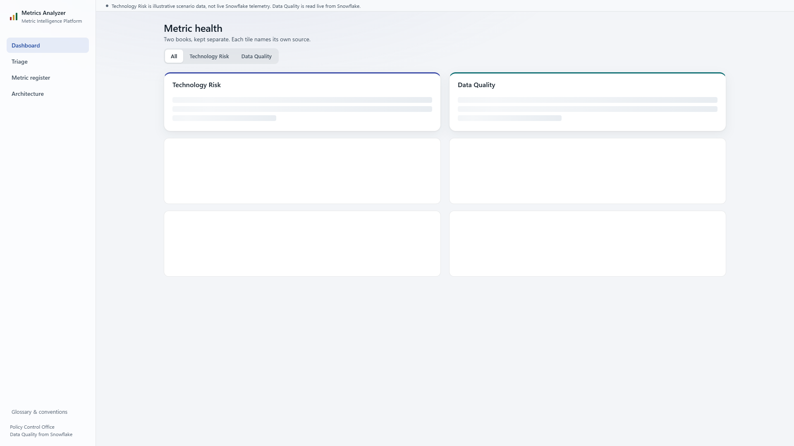
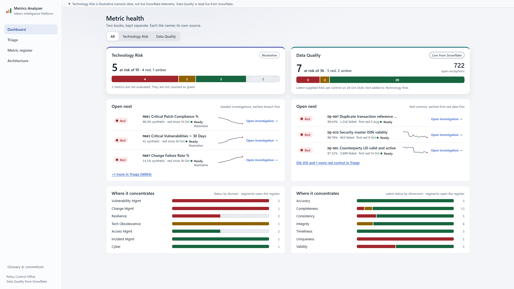
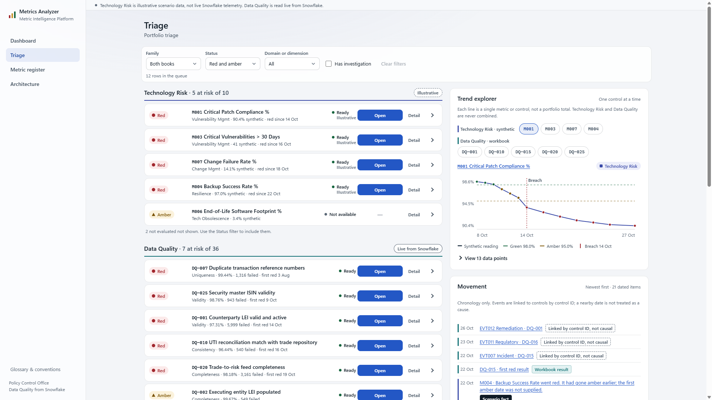
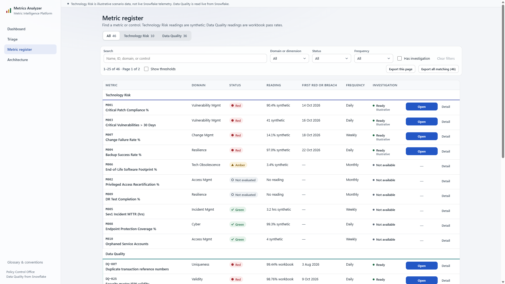
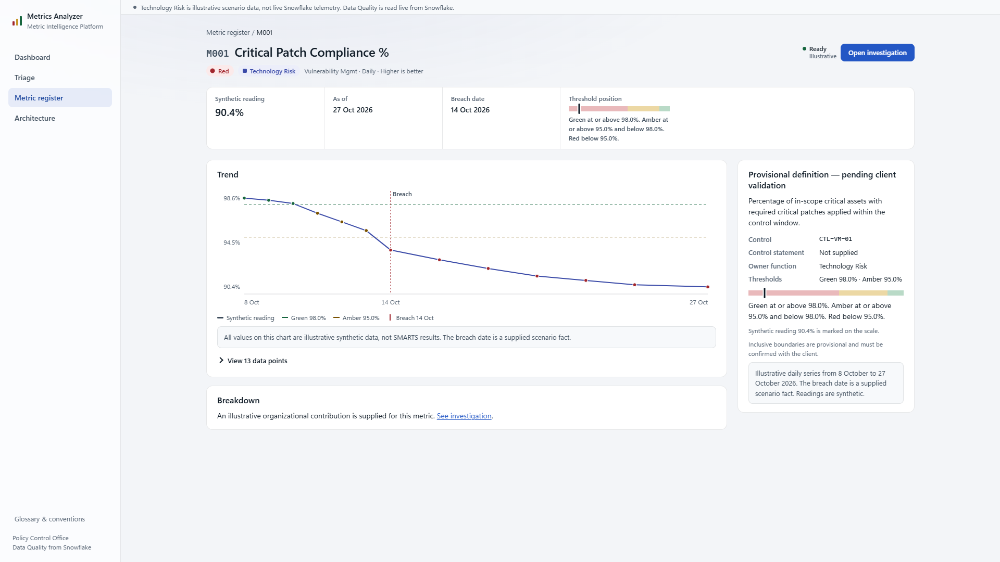

# Metrics Analyzer POC — URL inspection handoff

Inspection date: 4 Nov 2026, about 00:44–00:49 IST.
Inspector walked the live Cloudflare Pages site in a browser and read the React routes in this repo. Screenshots from that pass are in this folder. Another agent should treat this file as the description of the **deployed** URLs. The client dataset described at the end is **not** what those URLs render today.

## Shared origin

| Item | Value |
|---|---|
| Site | https://metrics-analyzer-poc.pages.dev |
| Entry the user shared | https://metrics-analyzer-poc.pages.dev/dashboard |
| Document title on every page | Metrics Analyzer |
| API the pages call | `https://metrics-analyzer-backend.sdeashirvad.com/api/v1` |
| Frontend source | `metrics-analyzer/frontend/src` |
| Router | `metrics-analyzer/frontend/src/App.tsx` |

`/` redirects to `/dashboard`. Unknown paths render the not-found page inside the same shell.

## What every URL shares

The app is a left sidebar plus a main column. The sidebar is 232px. The canvas is a light grey (`#f3f5f8`). Cards are white with a hairline border and 12px radius.

Sidebar, top to bottom:

- Brand mark (three bars), **Metrics Analyzer**, subtitle **Metric Intelligence Platform**.
- Primary nav: Dashboard, Triage, Metric register, Architecture. The current link is a pale blue pill.
- At the bottom, reference nav: **Glossary & conventions**.
- Foot: **Policy Control Office** / **Data Quality from Snowflake**.

Above the page content, a full-width note:

> Technology Risk is illustrative scenario data, not live Snowflake telemetry. Data Quality is read live from Snowflake.

A skip link, “Skip to content”, is the first focusable control.

Two books are kept visually separate. Technology Risk uses an indigo top rule (`#3b4ba8`). Data Quality uses a teal top rule (`#0f6f73`). Status colors are red, amber, green, and a hatched “not evaluated” segment. Provenance chips say **Illustrative** on Technology Risk and **Live from Snowflake** on Data Quality.

The product assumption on these URLs is a metric-health score: each metric or control has a direction, thresholds, and a RAG status. That is the older assumption. It is not the application-portfolio grain in the synthetic client file.

## Route index

| Path | Nav label | Page title | Query string the UI writes |
|---|---|---|---|
| `/dashboard` | Dashboard | Metric health | `view` = `technology_risk` or `data_quality`. Absent means All. |
| `/overview` | Triage | Triage | `family` = `technology_risk` or `data_quality`. `status` = `red`, `amber`, `insufficient_data`, `recovered`. `domain` = a domain or DQ dimension name. `inv=1` means “Has investigation”. |
| `/metrics` | Metric register | Metric register | `q`, `domain`, `status`, `frequency`, `family`, `inv=1`, `page`. |
| `/metrics/:metricId` | (no nav item) | `{id} {name}` | None. Example: `/metrics/M001`, `/metrics/DQ-007`. |
| `/investigations/:metricId` | (no nav item) | Investigation | None. Example: `/investigations/M001`, `/investigations/DQ-007`. |
| `/architecture` | Architecture | Architecture | `tab=proposed` selects the proposed diagram. Absent means the POC tab. |
| `/glossary` | Glossary & conventions | Glossary & conventions | In-page anchors only (`#gloss-ids` and similar). |

Deep links from the dashboard status strips go to the register with `family`, `domain`, and `status` already set. “Open next” overflow links go to `/overview?family=technology_risk` or `/overview?family=data_quality`.

## API calls observed while `/dashboard` loaded

These returned quickly enough for the page to fill. Durations are from the browser resource timing on that visit.

| Call | Role |
|---|---|
| `GET /api/v1/tr/metrics?page=1&pageSize=100` | Technology Risk book |
| `GET /api/v1/tr/overview` | Triage movement, hotspots, investigation summaries |
| `GET /api/v1/dq/overview` | Data Quality book |
| `GET /api/v1/tr/metrics/M001/trend` | Sparkline |
| `GET /api/v1/tr/metrics/M003/trend` | Sparkline |
| `GET /api/v1/tr/metrics/M007/trend` | Sparkline |
| `GET /api/v1/dq/controls/{DQ-001,DQ-002,DQ-007,DQ-010,DQ-015,DQ-020,DQ-025,DQ-032}/analyses/investigation` | Whether a saved DQ investigation exists |

Technology Risk investigation content is seeded in the API for a few ids (the UI treats M001, M003, M007, M004 as the seeded set). Data Quality investigations are loaded from Snowflake and can be run from the investigation route. The browser does not load a workbook itself.

## `/dashboard`

https://metrics-analyzer-poc.pages.dev/dashboard

**Title:** Metric health.
**Subtitle:** “Two books, kept separate. Each tile names its own source.”
**Control:** segmented radios All / Technology Risk / Data Quality. All was selected. Choosing one book sets `?view=` and restacks the grid so that book’s tile spans the width and the two cards sit beside it.

Layout is a 2-column, 3-row grid that fills **down each column** (status tile, Open next, Where it concentrates). Below 960px it becomes one column.

### First paint, before the API returns

Empty cards are real. Technology Risk and Data Quality tiles show skeleton bars. Two blank cards sit under each tile. Do not treat a blank card as missing data until the requests above finish.

### Loaded All view

**Technology Risk tile** (chip: Illustrative)

- Figure **5** “at risk of 10 · 4 red, 1 amber”.
- Footnote: “2 metrics are not evaluated. They are not counted as green.”
- Status strip, left to right: 4 red, 1 amber, 3 green, 2 hatched. Each segment links to the register filtered by that status.

**Open next** — “Seeded investigations, earliest breach first.” Three attention rows, then “+1 more in Triage (M004)”.

| Status | Id | Name | Fact line | Action |
|---|---|---|---|---|
| Red | M001 | Critical Patch Compliance % | 90.4% synthetic · red since 14 Oct · Ready · Illustrative | Open investigation |
| Red | M003 | Critical Vulnerabilities > 30 Days | 41 synthetic · red since 16 Oct · Ready | Open investigation |
| Red | M007 | Change Failure Rate % | 14.1% synthetic · red since 18 Oct · Ready | Open investigation |

Each row has a small sparkline. The link target is `/investigations/{id}`.

**Where it concentrates** — “Status by domain · segments open the register.”

| Domain | Count |
|---|---|
| Vulnerability Mgmt | 2 |
| Change Mgmt | 1 |
| Resilience | 2 |
| Tech Obsolescence | 1 |
| Access Mgmt | 2 |
| Incident Mgmt | 1 |
| Cyber | 1 |

**Data Quality tile** (chip: Live from Snowflake)

- Figure **7** “at risk of 36 · 5 red, 2 amber”.
- Aside: **722** open exceptions.
- Footnote: “Latest supplied RAG per control on 28 Oct 2026. Not added to Technology Risk.”
- Status strip: 5 red, 2 amber, 29 green.

**Open next** — “Red controls, earliest first-red date first.”

| Status | Id | Name | Fact line |
|---|---|---|---|
| Red | DQ-007 | Duplicate transaction reference numbers | 99.44% · 1,316 failed · first red 3 Aug · Ready |
| Red | DQ-025 | Security master ISIN validity | 98.76% · 945 failed · first red 9 Oct · Ready |
| Red | DQ-001 | Counterparty LEI valid and active | 97.31% · 5,999 failed · first red 14 Oct · Ready |

Overflow link: “DQ-010 and 1 more red control in Triage”.

**Where it concentrates** — “Latest status by dimension · segments open the register.”

| Dimension | Count |
|---|---|
| Accuracy | 3 |
| Completeness | 13 |
| Consistency | 5 |
| Integrity | 6 |
| Timeliness | 5 |
| Uniqueness | 1 |
| Validity | 5 |

Source in the repo: `frontend/src/features/dashboard/DashboardPage.tsx`. Styles: `.book-grid`, `.book-tile`, `.attention-list`, `.concentration` in `frontend/src/styles/pages.css`.

## `/overview` (nav label: Triage)

https://metrics-analyzer-poc.pages.dev/overview

**Title:** Triage. **Subtitle:** Portfolio triage.

Filter toolbar, one row:

- Family: “Both books” (also Technology Risk, Data Quality).
- Status: “Red and amber” (also Red, Amber, Not evaluated, Recovered).
- Domain or dimension: “All”.
- Checkbox: Has investigation.
- Clear filters, shown when any filter is on.
- Live count: “12 rows in the queue”.

The body is a 60/40 split. Left is the queue. Right is a rail labelled “Trend explorer and movement”. Below that, the code renders a Hotspots section and a validation section. Those were below the captured view.

**Technology Risk — 5 at risk of 10** (chip: Illustrative). Row shape: RAG badge, id and name, domain and fact, investigation state, Open button, Detail link.

| Id | Status | Domain | Fact | Investigation |
|---|---|---|---|---|
| M001 | Red | Vulnerability Mgmt | 90.4% synthetic · red since 14 Oct | Ready · Open |
| M003 | Red | Vulnerability Mgmt | 41 synthetic · red since 16 Oct | Ready · Open |
| M007 | Red | Change Mgmt | 14.1% synthetic · red since 18 Oct | Ready · Open |
| M004 | Red | Resilience | Backup Success Rate % · 97.0% synthetic · red since 22 Oct | Ready · Open |
| M006 | Amber | Tech Obsolescence | End-of-Life Software Footprint % · 3.4% synthetic | Not available · Detail only |

Note under the group: “2 not evaluated not shown. Use the Status filter to include them.”

**Data Quality — 7 at risk of 36** (chip: Live from Snowflake). Visible rows:

| Id | Status | Dimension | Fact |
|---|---|---|---|
| DQ-007 | Red | Uniqueness | 99.44% · 1,316 failed · first red 3 Aug · Ready |
| DQ-025 | Red | Validity | 98.76% · 945 failed · first red 9 Oct · Ready |
| DQ-001 | Red | Validity | 97.31% · 5,999 failed · first red 14 Oct · Ready |
| DQ-010 | Red | Consistency | UTI reconciliation match with trade repository · 98.64% · 540 failed · Ready |
| DQ-026 | Red | Completeness | Trade-ts risk feed completeness · 90.18% · 1,111 failed · first red 19 Oct · Ready |
| DQ-002 | Amber | Completeness | Executing entity LEI populated · 98.76% · 945 failed · Ready |

Open goes to `/investigations/{id}`. Detail goes to `/metrics/{id}`. A row can expand. Technology Risk expansion shows the seeded investigation summary. Data Quality expansion shows workbook facts.

**Trend explorer** (right rail): “One control at a time. Each line is a single metric or control, not a portfolio total. Technology Risk and Data Quality are never combined.” Chips for M001, M003, M007, M004 and for DQ-001, DQ-015, DQ-020, DQ-025. M001 was selected. The chart is a falling synthetic series from about 8 Oct to 27 Oct, with a breach marker on 14 Oct, a green line at 98.0%, and an amber line at 95.0%. Caption offers “View 13 data points”.

**Movement** — “Newest first · dated items. Chronology only. Events are linked by control ID. A nearby date is not treated as a cause.” Visible items included:

- 25 Oct — EVT012 Remediation — DQ-001 — Linked by control ID, not causal
- 22 Oct — EVT011 Regulatory — DQ-010 — Linked by control ID, not causal
- 21 Oct — EVT007 Incident — DQ-025 — Linked by control ID, not causal
- 22 Oct — DQ-015 — first red result — Workbook result
- 22 Oct — M004 — Backup Success Rate went red (the first amber date was not supplied)

Source: `frontend/src/features/overview/OverviewPage.tsx`, `TriageQueue.tsx`, `TrendExplorer.tsx`, `MovementRail.tsx`.

## `/metrics` (nav label: Metric register)

https://metrics-analyzer-poc.pages.dev/metrics

**Title:** Metric register.
**Subtitle:** “Find a metric or control. Technology Risk readings are synthetic. Data Quality readings are workbook pass rates.”

Segmented control with counts: **All 46**, **Technology Risk 10**, **Data Quality 36**.

Toolbar: search (“Name, ID, domain, or control”), Domain or dimension, Status, Frequency, Has investigation, Clear filters. Result line: “1–25 of 46 · Page 1 of 2”. Checkbox “Show thresholds”. Buttons “Export this page” and “Export all matching (46)”.

Table columns: METRIC, DOMAIN, STATUS, READING, FIRST RED OR BREACH, FREQUENCY, INVESTIGATION. A group header row splits Technology Risk from Data Quality. The metric name links to `/metrics/{id}`.

Technology Risk rows on page 1, in the order shown:

| Id | Name | Domain | Status | Reading | First red or breach | Frequency | Investigation |
|---|---|---|---|---|---|---|---|
| M001 | Critical Patch Compliance % | Vulnerability Mgmt | Red | 90.4% synthetic | 14 Oct 2026 | Daily | Ready · Open |
| M003 | Critical Vulnerabilities > 30 Days | Vulnerability Mgmt | Red | 41 synthetic | 16 Oct 2026 | Daily | Ready · Open |
| M007 | Change Failure Rate % | Change Mgmt | Red | 14.1% synthetic | 18 Oct 2026 | Weekly | Ready · Open |
| M004 | Backup Success Rate % | Resilience | Red | 97.0% synthetic | 22 Oct 2026 | Daily | Ready · Open |
| M006 | End-of-Life Software Footprint % | Tech Obsolescence | Amber | 3.4% synthetic | — | Monthly | Not available |
| M002 | Privileged Access Recertification % | Access Mgmt | Not evaluated | No reading | — | Monthly | Not available |
| M009 | DR Test Completion % | Resilience | Not evaluated | No reading | — | Monthly | Not available |
| M005 | Sev1 Incident MTTR (hrs) | Incident Mgmt | Green | 3.2 hrs synthetic | — | Weekly | Not available |
| M008 | Endpoint Protection Coverage % | Cyber | Green | 90.3% synthetic | — | Daily | Not available |
| M010 | Orphaned Service Accounts | Access Mgmt | Green | 4 synthetic | — | Weekly | Not available |

Data Quality then continues (36 controls). The first visible row was DQ-007, Uniqueness, Red, 99.44% workbook, first red 3 Aug 2026, Daily, Ready. Page 2 holds the rest. Below 800px the table becomes stacked cards and hides the header.

Source: `frontend/src/features/register/RegisterPage.tsx`.

## `/metrics/:metricId`

Example walked: https://metrics-analyzer-poc.pages.dev/metrics/M001

Breadcrumb: Metric register / M001. The back target remembers whether the user came from the register, triage, or dashboard.

**Heading:** M001 Critical Patch Compliance %.
**Chips:** Red · Technology Risk · Vulnerability Mgmt · Daily · Higher is better.
**Action:** investigation state “Ready” and a primary **Open investigation** button to `/investigations/M001`.

Key-facts strip:

| Synthetic reading | As of | Breach date | Threshold position |
|---|---|---|---|
| 90.4% | 27 Oct 2026 | 14 Oct 2026 | Green at or above 98.0%. Amber at or above 95.0% and below 98.0%. Red below 95.0%. |

Main column, about two thirds:

- **Trend.** Daily synthetic series from 8 Oct to 27 Oct 2026. Green guide at 98.0%, amber guide at 95.0%, breach marker on 14 Oct. The line falls from just under 98% to 90.4%. Disclosure: “View 13 data points”. Caption: values are illustrative synthetic data, not SMARTS results. The breach date is a supplied scenario fact.
- **Breakdown.** “An illustrative organizational contribution is supplied for this metric.” Link: See investigation.

Sticky rail, **Provisional definition — pending client validation**:

- “Percentage of in-scope critical assets with required critical patches applied within the control window.”
- Control: CTL-VM-01
- Control statement: Not supplied
- Owner function: Technology Risk
- Thresholds: Green 98.0%, Amber 95.0%
- A small threshold scale with the 90.4% reading marked
- Note that inclusive boundaries are provisional and must be confirmed with the client

A Data Quality id such as `/metrics/DQ-025` uses the same frame. The reading is a workbook pass rate. The rail and the lower tabs carry the control’s regulation, report, CDE, source system, check logic, desk breakdown, and exception evidence. Those DQ-only blocks were not screenshotted on this pass. Source: `frontend/src/features/metric/MetricDetailPage.tsx` and `DqEvidence.tsx`. Layout classes: `.key-facts`, `.detail-layout` (main + 340px sticky rail).

## `/investigations/:metricId`

Not screenshotted on this pass. The route is real and is the target of every **Open** and **Open investigation** control.

- `/investigations/M001` (and M003, M007, M004) opens a seeded Technology Risk narrative: headline, what changed, why it matters, timeline, signals split into scenario fact versus hypothesis, lineage, an org hotspot chart when one was supplied, and a “path to green” that the UI labels as illustrative checks. Copy on the page says it is not a Snowflake Cortex response and not connected to SMARTS.
- Any other Technology Risk id has no investigation. The page says so and points back to the metric.
- `/investigations/DQ-007` (any `DQ-` id) loads or runs a Data Quality investigation. States the UI knows: Ready, Not run, Running, Not available, Checking. Run starts a job. A later open can return the saved Cortex result after it has been checked against the retrieved facts.

Source: `frontend/src/features/investigation/InvestigationPage.tsx`.

## `/architecture`

https://metrics-analyzer-poc.pages.dev/architecture

Not screenshotted on this pass. Confirmed from the route and `frontend/src/features/architecture/`.

Tabs: **POC** (default) and **Proposed** (`?tab=proposed`). Each tab is a diagram plus a list fallback under 1180px, a legend (implemented / upcoming / proposed, and data / control / async edges), a walkthrough with play and step controls, and a detail panel for the selected node. Walkthrough roles: requester, waiting on a child process, active step, completed. Reduced motion is respected.

The POC graph is the system these URLs already run: Pages UI, the API, Snowflake for Data Quality, seeded Technology Risk. The proposed graph is a later design drawn on the same page. It is still the two-book design, not the application dataset below.

## `/glossary`

https://metrics-analyzer-poc.pages.dev/glossary

Not screenshotted on this pass. Confirmed from `frontend/src/features/glossary/GlossaryPage.tsx`.

Narrow column, max 880px. Title: “Glossary & conventions.” Subtitle says Technology Risk and Data Quality use different sources. A contents row links to sections. Terms are a two-column definition list. The page explains identifiers (M00x versus DQ-0xx), RAG, the environment-bar sentence, and evidence tags: fact, workbook, established, hypothesis, linked, recommendation, not supplied. It loads M001 and DQ-025 so the examples match the live API.

## How to read a URL

1. The host is the Pages app. Data comes from `metrics-analyzer-backend.sdeashirvad.com`, not from the page itself.
2. `M00x` is a Technology Risk metric. The number is synthetic. Only some of them have a seeded investigation.
3. `DQ-0xx` is a Data Quality control. The percentage is a workbook pass rate stored in Snowflake. “Live from Snowflake” does not mean a live SMARTS feed.
4. Red, amber, and green are threshold judgments. “Not evaluated” is a missing reading, and the dashboard does not count it as green.
5. The two books are never added together. The dashboard says so, and the triage chart says so.
6. A blank dashboard is the loading skeleton. Wait for `/tr/metrics`, `/tr/overview`, and `/dq/overview`.

## What these URLs are not

They do not show the synthetic enterprise file. That file is the new client requirement and lives outside the deployed site:

`C:\Users\aashirvad\Downloads\metrics_analyzer_synthetic_dataset_bundle\client_dataset_output\`

- `synthetic_enterprise_data.csv` — 11,399 data rows, 57 columns. SHA-256 prefix `08df1af542daf11c`.
- One row is one `METRIC_ID` for one application (`EON_ID`) at one month-end.
- 1,500 applications, 24 metrics in 6 families, 12 month-ends from 30 Nov 2025 through 31 Oct 2026.
- October 2026, distinct applications: 923.
- October row mix: Compliant 463, Non_Compliant 324, Pending 183, Not_Applicable 126.
- Provisional compliance rate in October: 53.04% (`SUM(IS_NUMERATOR) / SUM(IS_DENOMINATOR)`). That formula is a generator assumption.
- Newly non-compliant applications in October, under the documented provisional definition: 132.
- Failed completed-test rows in October: 273.
- M&A applications with a non-compliant row in October: 29.
- Asset-risk codes and application tiers have no severity direction. They are not a RAG scale.
- `TOTAL_RFB` repeats on every metric row of an application-month. Aggregate it with `MAX` per application-month.

A screen-by-screen proposal for pointing this same chrome at that file is in the canvas [Application portfolio design](C:\Users\aashirvad\.cursor\projects\c-Users-aashirvad-Documents-ControlLens\canvases\application-portfolio-design.canvas.tsx). The deployed routes above still render the two-book POC.

## Screenshot index

| File | URL | What it shows |
|---|---|---|
| `01-dashboard-loading.png` | `/dashboard` | Shell and skeleton before the books fill |
| `02-dashboard-loaded.png` | `/dashboard` | Both books, open-next lists, concentration |
| `03-triage.png` | `/overview` | Filters, both queues, trend explorer, start of movement |
| `04-register.png` | `/metrics` | Register header and the first 25 rows |
| `05-metric-m001.png` | `/metrics/M001` | Detail layout for a Technology Risk metric |

Architecture, glossary, a Data Quality detail page, and an investigation page were not captured as images on this pass. Their structure is from the source files named above and from the links those screenshots expose.
