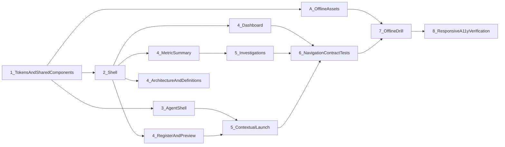

# Metrics Analyzer V2: Frontend One-Shot Execution Plan

Companion to `FRONTEND_UX_AUDIT.md` (issue IDs refer to its register). Paths are relative to `metrics-analyzer/`.

Goal: a simpler, more coherent, premium analytics product with one central Agent workspace and screens that still render when Snowflake is slow or down. Only live Agent chat may be unavailable.

## 1. Principles

1. One conversational surface: `/agent`. No chat on any other page except through navigation to it.
2. Prepared content is ordinary read-only application data. It never behaves like an Agent interaction.
3. One design owner, one token file, one set of shared components. Pages consume them; they do not restyle them.
4. Remove or consolidate before adding. No new UI framework, no new persistence, no new endpoint.
5. Preserve `/legacy/*`, `/api/v1/dq/*`, `/api/v1/tr/*`, the Architecture page, both Cortex Agents and the existing context API contract.

## 2. Agent navigation contract (mandatory)

| Source | Control label | Behaviour | Resulting URL | Context |
|---|---|---|---|---|
| Dashboard header | Ask Agent | Link (no dialog) | `/agent` | General portfolio context |
| Metric Summary header | Ask Agent | Link | `/agent` | General portfolio context |
| Metric Investigation header | Ask Agent | Link | `/agent` | General portfolio context |
| Application Investigation header | Ask Agent | Link | `/agent` | General portfolio context |
| Definitions, Architecture | none | No Agent action | n/a | n/a |
| Metric Register Preview | Chat with Agent | Link (no dialog) | `/agent?focusMetric={METRIC_ID}&month={YYYY-MM-DD}&{scope params}&ctx=preview` | Selected metric, month and active filters seeded; shown in the right-hand context rail |
| Sidebar / top bar | Agent | Link | `/agent` | General |
| Agent workspace | Select agent, send, follow up | Stays in the workspace; creates or continues a Snowflake thread | `/agent/:agentKey`, `/agent/:agentKey/:conversationId` | Existing thread context |

Rules that make the table testable:
- Only `RegisterPage.tsx` (Preview) may pass `focusMetric`. No other component may append `focusMetric`, `eonId` or filters to `/agent`.
- No `Dialog`, drawer or inline composer outside `features/agent/`. `ContextComposer` and the contextual `Dialog` branch of `ChatWithAgentButton` are deleted.
- All three Agent route variants render the same workspace shell (see 5.9).

### 2.1 Context API verification (done, source-level)

Verified in `backend/app/agents/router.py`, `models.py`, `context/builder.py`, `conversations.py`, `registry.py`:

| Question | Finding |
|---|---|
| Reference creation | There is no server-side reference. The context is stateless: the client sends a `ContextRequest` (`entrySurface`, `scope{metricId, eonId, month, filters}`, optional `items.include/exclude`) to `POST /api/v1/agents/context/preview`. |
| Resolution | The server rebuilds context from the request on every call and returns `contextHash` (digest of the rendered text), `items`, `chips`, `scope`, `rendered.text`. |
| Payload bounds | Pydantic `extra="forbid"`; rendered context capped at `MAX_CONTEXT_CHARS = 12000` (`CONTEXT_TOO_LARGE`); filters, month, tier, ma, orgTree validated (`UNKNOWN_FILTER_VALUE`, `UNKNOWN_MONTH`). |
| Expiry or lifecycle | None server-side. `POST /conversations` re-derives context and rejects a changed one with `409 CONTEXT_STALE`. Reviewed context is kept in `sessionStorage` key `ma2:ctx`. |
| Failure behaviour | Typed codes: `VALIDATION_FAILED`, `CONTEXT_INVALID`, `METRIC_NOT_FOUND` (404), `APPLICATION_NOT_FOUND` (404), `UNKNOWN_MONTH`, `DATA_SOURCE_UNAVAILABLE` (503, retryable), `CONTEXT_STALE`. |
| Surface rules | `register_preview` requires a `metricId`; scoping a metric outside a contextual entry surface is refused (`CONTEXT_INVALID`). |

Conclusion: the existing contract supports the Preview launch without any API change. "Bounded context reference" is implemented as bounded scalar identifiers in the URL (`focusMetric`, `month`, filter query params already produced by `scopedTo`), which the workspace converts into a `ContextRequest`. No raw JSON in the URL.

Dependencies recorded:
- D-A: the workspace derives `register_preview` from the mere presence of `focusMetric` (`AgentPages.tsx`). Add an explicit `ctx=preview` marker so only the Preview can seed and a stray `focusMetric` is ignored.
- D-B: unknown or malformed `focusMetric` returns 404 and invalid month returns 400; the rail must show an inline "context unavailable" state and fall back to portfolio context.
- D-C: preview depends on a live Snowflake read (`DATA_SOURCE_UNAVAILABLE` when down). That is acceptable because chat itself needs Snowflake. The rail must say so.
- D-D: no lifecycle or expiry exists; none is needed because the URL carries identifiers, not a token.

## 3. Shared design system (build first, single owner)

Source: `frontend/src/v2/styles/tokens.css`, `base.css`, `components.css`, `pages.css`, `features/dashboard/DashboardPage.css`, `components/present.tsx`, `components/MenuSelect.tsx`, `components/ui/PageHeader.tsx`, `components/charts/Charts.tsx`.

Required change:
1. Extend `tokens.css` with the six-step type scale (`--fs-12/13/14/16/20/28`), line heights, `--control-h: 36px`, `--control-h-sm: 32px`, a single card radius and shadow. Delete `--dash-*` from `DashboardPage.css` and map its colours to existing tokens (`--canvas`, `--surface`, `--hairline`, `--accent`).
2. Replace literal font sizes 10, 10.5, 11, 11.5, 12.5 px with tokens across `components.css`, `pages.css`, `DashboardPage.css`, `architecture.css`.
3. Create or consolidate shared components: `Card` (title, optional action, optional footer), `Button` variants, `SegmentedControl`, `MenuSelect` (corrected roles), `DataTable` (stacked mode below 720 px), `RagPill`, `StatusChip`, `EmptyState`, `ErrorState`, `AsOfNote`, `AskAgentLink`.
4. `AskAgentLink` is the only component allowed to link to `/agent` from non-Agent pages. Label `Ask Agent`, one icon, `variant="header"`.
5. `LineChart` and `BarList` keep their API; `LineChart` is already container-responsive (changed this session); add optional last-value and axis labels.

Acceptance: only the six type sizes appear in a computed-style sweep of every route; no page defines its own palette; every interactive control is at least 32 px tall; a single `Button` class set is used.
Regression tests: add component tests for `MenuSelect` roles, `DataTable` stacking, `AskAgentLink` href; keep `markdown.test.tsx`, `scale.test.ts`, `query.test.ts`.
Dependencies: none (first).

## 4. Offline-first data plan (backend assets, no new infrastructure)

The goal is that every non-chat screen renders from backend-stored data when Snowflake is slow or down.

Current coverage (verified): packaged fallback exists for overview, trends, testing distribution, organisation contribution, risk distribution and applications (default scope, latest month only, `portfolio/fallback.py`). It is missing for: filters, compliance distribution, legal-entity and tier distributions, data coverage, Metric Register, Preview, Summary, Trend, Breakdowns, metric applications, application detail and history, and both Investigations (prepared bundles exist for six metrics only).

Plan (reuses `fallback_assets/v2/` and the `runtime.execute(... fallback_fn=...)` mechanism; no new database, persistence or endpoint):
1. Add packaged JSON for each missing read in the default scope and latest month, generated from the same Snowflake views by an offline export script (the existing export folder pattern `snowflake/mock_data_setup/export`). Required assets:
   - `compliance_distribution.json`, `attribute_distributions.json` (legal entity, tier, risk, lifecycle), `data_coverage.json`, `filters_catalog.json`.
   - `metric_register.json` (all 24 metrics: rate, RAG, movement, sparkline, rows).
   - `metric_detail/{METRIC_ID}.json` for all 24 metrics: summary, trend, breakdowns by dimension, affected-application page one, contributors, path-to-green inputs.
   - `application_detail/{EON_ID}.json` for the applications that appear in attention lists and metric contributors (bounded set) with history.
   - `investigations/` bundles for the metrics that are not Healthy first, then the rest as time allows; metric investigation payload assets for all 24.
2. Wire each `fallback_fn` (`metrics.py` replaces `_no_fallback`, `investigations.py`, `applications.py`, `dashboard.py` compliance/attributes/coverage/filters) to the matching asset, returning the same envelope with `source: "packaged"` and the dataset `asOf`.
3. Timeout behaviour: keep the 5 s read budget and the 30 s gate. On timeout or dependency failure, serve the asset instead of raising `FALLBACK_UNSUPPORTED`. Unsupported combinations (non-default filters or month) show an inline, specific message, never fabricated numbers.
4. UI: the status bar shows `Demo dataset · {month}`; when `meta.source === "packaged"`, `AsOfNote` appends a subtle `· prepared {asOf}`. No warning banner.
5. Prepared Analysis (Investigation): a read-only section rendered from the existing `agentAnalysis` field. It has no composer, selector, follow-up, history or polling. It shows backend-provided freshness (`generatedAt`, dataset version) and its source-fact limitation line. Reuse the existing six bundles; extend only through the existing generator `app/agents/prepare_investigations.py` in a separate, explicitly approved step. This is not a second conversation lifecycle.
6. Agent route when Snowflake is down: the workspace shows "Live chat is unavailable right now" with Retry, existing conversations listed from local metadata, and no fabricated answer.

Acceptance: with Snowflake unreachable (simulate by pointing the API at an invalid account in a throwaway process), every route except `/agent` send renders complete default-scope content, and `/agent` shows the unavailable state.
Regression tests: backend tests that every portfolio endpoint returns `source == "packaged"` when `connect_read` raises; the existing `tests/v2/portfolio` suites; frontend test that `AsOfNote` appears for packaged meta.
Dependencies: independent of UI work except `AsOfNote` (section 3).

## 5. Per-page work items

Each item lists: route and component; existing source; change; design and interaction; dependencies; reusable components; acceptance; regression tests.

### 5.1 Application shell (G-01, G-02, G-04)
- Source: `shell/V2Shell.tsx`, `styles/pages.css` (sidebar and 800 px top bar).
- Change: below 900 px replace the stacked top bar (157 to 252 px) with a 56 px bar: brand, current page, menu button that opens the navigation sheet. Move the Recent conversations list into the Agent page rail and the nav sheet only.
- Design: sidebar 232 px persists at 1024 and above; status line stays one row.
- Dependencies: section 3.
- Acceptance: at 390 and 768 px the top bar is at most 64 px; no Recent list in the bar; all nav targets at least 40 px.
- Tests: component test for menu open and Escape; iframe geometry sweep script from the audit.

### 5.2 Dashboard (D-01 to D-07)
- Source: `features/dashboard/DashboardPage.tsx`, `DashboardPage.css`, `charts/Charts.tsx`.
- Change:
  1. Header action becomes `AskAgentLink` "Ask Agent" to `/agent`.
  2. "Open findings" KPI becomes non-interactive (no findings view exists), or links to a findings view only if one is built.
  3. Legal entities card keeps six rows and View all; labels use the one agreed legal-entity label (`label` plus code on hover).
  4. Reduce card copy to one subtitle line; move "not application count" explanations to a tooltip and Definitions.
  5. `LineChart`: add y-axis labels and the last value.
  6. Keep the current column balance (equal heights, trend full width, org/legal pair).
- Acceptance: no secondary line longer than one row; Legal list shows six rows; every KPI destination matches its label; label and drill value agree for legal entities.
- Tests: `DashboardPage` render test for hrefs (add), existing `scale.test.ts`.

### 5.3 Metric Register and filters (R-01 to R-07)
- Source: `features/register/RegisterPage.tsx`, `components/MenuSelect.tsx`, `ScopeBar.tsx`.
- Change:
  1. One filter surface: scope bar plus a single row (search, sort, RAG, "More" popover with denominator, non-compliant only, page size).
  2. `MenuSelect` roles corrected (`menu` with `menuitemcheckbox`, or `listbox` with `option`), arrow-key navigation, focus trap and return.
  3. Row link names use the metric id ("Open M340202 definition").
  4. Metric column shows ID plus family or PD id when available; no invented names.
  5. Info icon sits inline with the rate.
- Preview: keep the centred drawer (480 to 520 px, max 70vh, Escape and focus return, bottom sheet on phones). Actions: primary "Open Summary / Details", secondary "Open Investigation", secondary "Chat with Agent" (link to `/agent` with seeded identifiers, see section 2).
- Acceptance: the contract row for Preview holds; table never reflows when Preview opens; filters reset in one action.
- Tests: Preview href test (focusMetric, month, `ctx=preview`); keyboard test for `MenuSelect`.

### 5.4 Metric Summary (S-01 to S-05)
- Source: `features/metric/MetricSummaryPage.tsx`, `MetricTrendCard.tsx`, `MetricFunnel.tsx`.
- Change: title is `METRIC_ID` with family or definition id when present; breakdown tabs use labels (Organisation, Legal entity, Tier, Risk, Lifecycle, Reason, Test status); replace the formula block with a single line and a link to the Definitions anchor; "Ask Agent" is a plain `/agent` link; Summary stays reference: calculation, result and RAG, trend, distributions, breakdowns.
- Acceptance: no raw keys; no formula duplicated; Agent link has no query string.
- Tests: label-mapping unit test; href test.

### 5.5 Metric and application Investigation (I-01 to I-08)
- Source: `features/investigation/MetricInvestigationPage.tsx`, `ApplicationInvestigationPage.tsx`, `AgentAnalysisPanel.tsx`, `investigationState.ts`, `PathToGreen.tsx`, `styles/pages.css` (`.investigation-layout`).
- Change:
  1. Delete the sticky aside layout. Use one full-width column ordered: header with "Ask Agent" link; Impact (rate/RAG, affected, movement, tests as one KPI row); Where concentrated (contributors); Path to Green; Affected applications (first 10, View all); Prepared Analysis (read-only).
  2. Replace `AgentAnalysisPanel` with `PreparedAnalysis` (new, read-only): label "Prepared analysis", as-of line, rendered through the existing markdown component, limitation line, no composer, no selector, no polling, no thread recovery. Remove `readAnalysisLink`, `writeAnalysisLink`, `panelPhase` use and related storage keys from the UI path (files may remain until a cleanup step).
  3. Hide parser warnings (`MULTIPLE_QUERIES`) from the UI.
  4. Prepared bundle copy must not contradict Path to Green; for Healthy metrics show the section only if the narrative agrees with the central threshold (see section 4 for regenerating bundles outside this scope).
  5. Application Investigation: History strip only, list on demand; responsive tables (`DataTable` stacked mode); "Ask Agent" plain link.
- Path to Green: keep as is (current rate and RAG, threshold 0.45, gap, contributors, proposals clearly labelled not done, no owners, expected next-period change). Application target stays Compliant, Test_Complete, Pass, with Pending and Not_Applicable distinct.
- Acceptance: no element on these pages is wider than the viewport; no `textarea` on the page; page at 1440 px is under 3,500 px tall for M340202; Prepared Analysis has no interactive Agent controls.
- Tests: replace `investigationState.test.ts` cases with `PreparedAnalysis` tests (renders markdown, as-of, no warnings, no textarea); DOM test that investigation pages contain no `textarea` or `role="dialog"`.

### 5.6 Central Agent workspace and general conversation (A-01 to A-05)
- Source: `features/agent/AgentPages.tsx`, `MessageViews.tsx`, `ChatWithAgent.tsx`, `agent/conversationStore.ts`, `hooks/useAgentRun.ts`.
- Change: introduce one `AgentShell` (agent picker, thread, composer, context rail) used by `AgentHome`, `NewConversationPage` and `ConversationPage`. Route params only set state (agent, conversation). The rail is present in all variants and collapses behind a toggle below 900 px. Conversation titles truncate with an ellipsis. Remove `ContextComposer` and the dialog branch of `ChatWithAgentButton`.
- Acceptance: the three routes share identical outer layout; switching agent or opening a conversation does not remount the shell; the rail shows scope, period, entity, filters, definitions; composer is one box.

### 5.7 Contextual launch from Preview (R-06, S-04, I-06)
- Source: `RegisterPage.tsx`, `ChatWithAgent.tsx`, `AgentPages.tsx`, `agent/contextClient.ts`, `scopePath.ts`.
- Change: Preview button is an `AskAgentLink` variant that builds `/agent?focusMetric=...&ctx=preview&month=...` plus current scope params. `AgentWorkspace` seeds `register_preview` only when `ctx=preview` and `focusMetric` are both present; otherwise uses `general`. The rail previews the exact request sent (same `contextHash`). User must pick an Agent before sending.
- Error states: unknown metric or month shows an inline rail error and falls back to general context.
- Acceptance: the context in the rail equals the `context` sent in `POST /conversations`; a Summary or Investigation link never seeds; no JSON in the URL.
- Tests: `contextClient` build-request test; route test for the two seeding conditions.

### 5.8 Agent response types (A-02)
- Source: `MessageViews.tsx`, `backend/app/agents/parse.py`.
- Change: Analysis keeps markdown, tables, SQL, suggestions. Data Explorer renders: interpretation (once), assumptions (collapsed), SQL (once, with Copy), result table (with Export), caveats. Unknown content blocks render as plain text.
- Acceptance: each of intent and SQL appears exactly once per message; tables scroll inside the bubble without page overflow.
- Tests: extend `markdown.test.tsx`; add a `MessageViews` test with a Data Explorer fixture containing intent and SQL.

### 5.9 Architecture and Definitions (AR-01, DF-01, DF-02)
- Source: `features/architecture/*`, `features/definitions/DefinitionsPage.tsx`.
- Architecture: unchanged behaviour; reword "Data Quality" copy; apply shared tokens only. Keep Play, Replay and arrow keys.
- Definitions: add a grouped index with anchors (Classification, Rates, Application states, Organisation, Derived); keep every card; the Summary and Investigation link here instead of repeating formulas.
- Tests: `journey.test.ts` unchanged; anchor navigation test.

### 5.10 Responsive behaviour and accessibility
- Targets: 1440, 1366, 1280, 1024, 768, 390.
- Rules: two-column dashboard at 1024 and above (single below); KPI row 4 up at 1280, 2 up below; tables stack below 720 px; Preview is a drawer above 800 px and a bottom sheet below; Agent rail collapses below 900 px.
- Accessibility: roles on menus; unique link names; visible focus (global `:focus-visible` already present, verify on the composer wrapper); `prefers-reduced-motion` handled globally in `base.css`; contrast checked for muted text (`--ink-3` on `--canvas`) with a tool; tap targets at least 32 px.
- Acceptance: iframe geometry sweep shows no element wider than its viewport and no clipped table at any width; keyboard-only run through Register to Preview to Agent succeeds.

## 6. Issue to work item map

| Issues | Work item |
|---|---|
| G-01, G-04 | 5.1 |
| G-02, G-03 | 3 |
| D-01 to D-07 | 5.2 |
| R-01 to R-07 | 5.3 |
| S-01 to S-05 | 5.4 |
| I-01 to I-08 | 5.5 |
| A-01, A-03, A-04, A-05 | 5.6 |
| R-06, S-04, I-06 | 5.7 |
| A-02 | 5.8 |
| AR-01, DF-01, DF-02 | 5.9 |
| O-01 | 4 |
| Responsive and accessibility | 5.10 |

## 7. Implementation order and parallelisation

- Single owner, sequential: step 1 (tokens, `Card`, `Button`, `MenuSelect`, `DataTable`, `AskAgentLink`, `AsOfNote`), step 2 (shell), and the whole Agent track (3 and 5.7/5.8), because `AgentPages.tsx`, `ChatWithAgent.tsx` and `MessageViews.tsx` are shared.
- Safe to parallelise after step 2 (separate files, shared components only consumed): Dashboard, Register and Preview presentation, Metric Summary, Architecture and Definitions, and the backend offline-asset track A (separate directory, no frontend files).
- Investigations (5) depend on `DataTable` and `PreparedAnalysis`; do after Summary so the Ask Agent and table patterns are settled.
- Do not run multiple agents editing `components.css`, `pages.css` or `tokens.css`; those belong to the design owner.
- Final integration: wire `AskAgentLink` everywhere, delete `AgentAnalysisPanel`, `ContextComposer` and dead imports, run the contract tests, then the offline drill, then the viewport sweep.

## 8. Verification plan

1. `npm test` and `npm run build` in `frontend/`; backend `pytest tests/v2`.
2. Navigation contract: scripted check that, for each source in the table in section 2, the control's `href` matches and that no `textarea` or `dialog` exists outside `/agent`.
3. Live walk at the six viewports using the same geometry sweep used in the audit (no overflow, no clipped tables, shell height limits).
4. Live Agent check: one message per Agent through the new workspace; render check for Analysis and Data Explorer; reload recovery; unavailable-state check with Snowflake unreachable.
5. Offline drill (section 4 acceptance).
6. Keyboard-only and screen-reader name check on Register, Preview and Agent.

## 9. Out of scope

Backend or Snowflake schema changes; new Agents; new persistence; changes to `/legacy/*`, `/api/v1/dq/*`, `/api/v1/tr/*`; new npm dependencies; regeneration of Agent bundles (a separate approved step).
